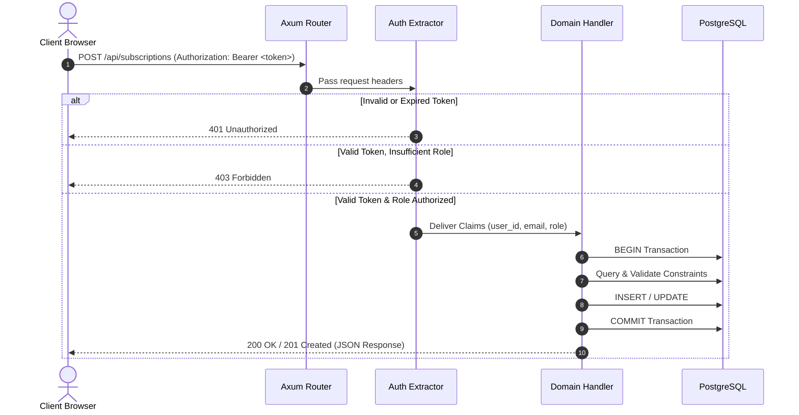
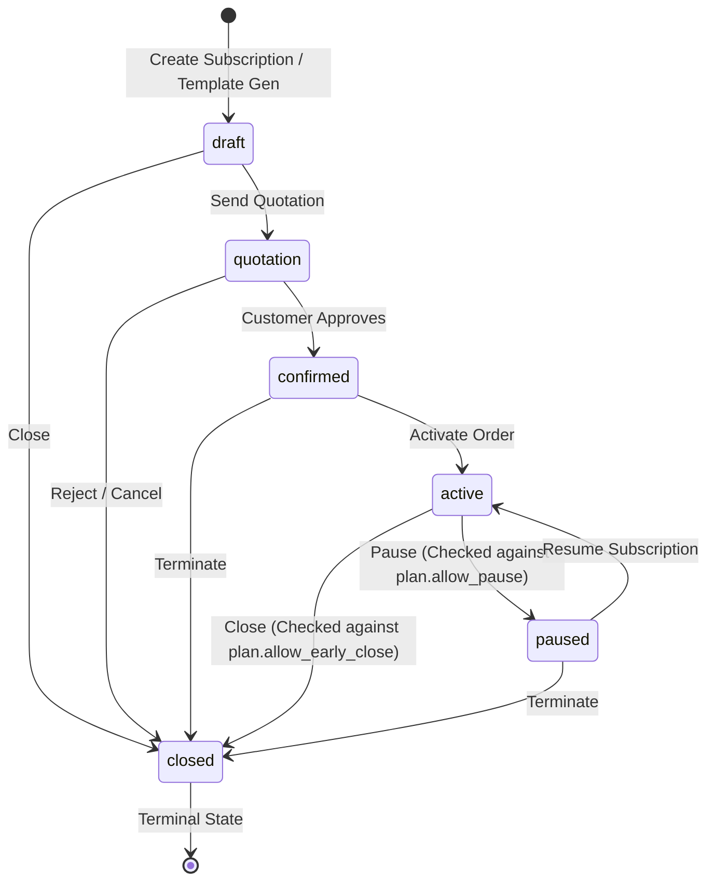
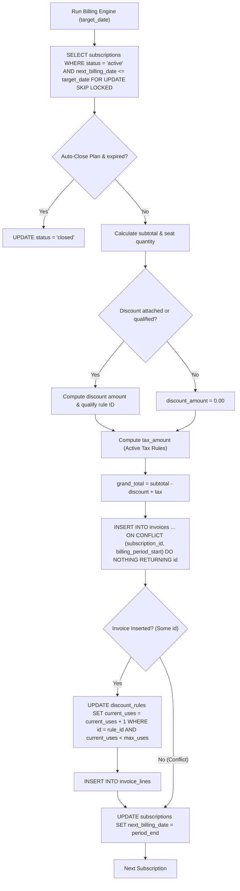
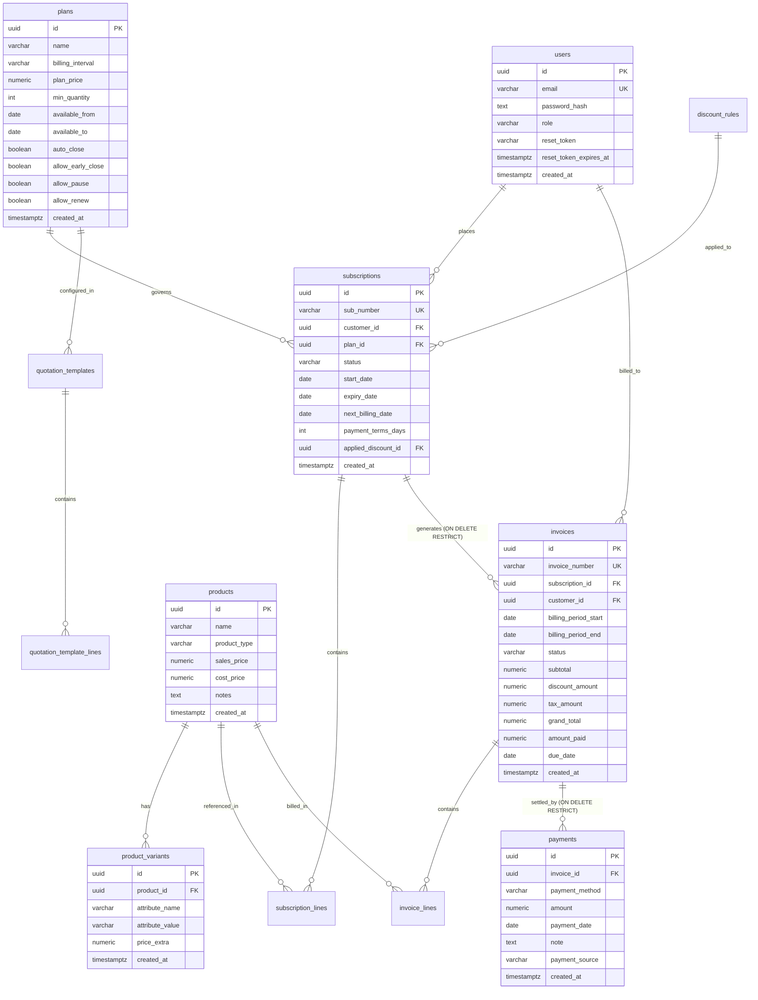

# System Architecture & Technical Design

Brightloop is a multi-tier subscription billing system. This document outlines the system architecture, request lifecycles, state machine specifications, recurring billing mechanics, and financial calculation flows.

---

## 1. System Overview

Brightloop is organized into a React single-page frontend, a compiled Rust web server (`axum`), and a PostgreSQL relational database.

```mermaid
flowchart TD
    subgraph ClientLayer ["Client Layer (Browser)"]
        SPA["React 18 SPA (Vite + TailwindCSS)"]
        DevBar["Dev Time-Travel Toolbar (Dev Only)"]
    end

    subgraph ServerLayer ["Server Layer (Rust Axum Binary)"]
        Router["Axum Router (/api/*)"]
        AuthMiddleware["Auth Extractors (JWT Verification)"]
        Handlers["Domain Route Handlers"]
        Worker["Tokio Background Billing Worker (60s Loop)"]
        Engine["Billing Rules & Date Engine"]
    end

    subgraph DataLayer ["Data Layer (PostgreSQL)"]
        DB[(PostgreSQL 16+ Database)]
        Tables["Tables: users, plans, subscriptions, invoices, payments..."]
        Constraints["Unique Constraints & Foreign Keys"]
    end

    SPA -->|HTTP / JSON Requests| Router
    DevBar -->|Simulate Billing & Seed| Router
    Router --> AuthMiddleware
    AuthMiddleware --> Handlers
    Handlers -->|SQL Queries (sqlx)| DB
    Worker -->|Execute Cycle| Engine
    Engine -->|FOR UPDATE SKIP LOCKED & Insert Invoices| DB
```

---

## 2. Request Lifecycle

Every incoming HTTP request follows an explicit pipeline through Axum extractors before reaching domain logic:



### Extractor Hierarchy

Axum leverages Rust's type system to enforce authorization before handler execution:

1. **Public Handlers** (e.g. `/api/auth/login`, `/api/health`): No extractor required.
2. **`AuthenticatedUser`**: Decodes and verifies the HMAC-SHA256 JWT from the `Authorization: Bearer` header. Fails with `401 Unauthorized` if invalid or expired.
3. **`RequireStaffOrAdmin`**: Verifies the decoded token role is either `staff` or `admin`. Returns `403 Forbidden` if role is `customer`.
4. **`RequireAdmin`**: Enforces that the decoded role is strictly `admin`. Returns `403 Forbidden` for all other roles.

---

## 3. Subscription State Machine

Subscription lifecycles in Brightloop follow a finite state machine defined in [`backend/src/handlers/subscriptions/status.rs`](file:///C:/nan/odoo/backend/src/handlers/subscriptions/status.rs#L45-L68).



### Transition Rule Table

| Initial State | Target State | Permitted? | Guard / Policy Enforcement |
| :--- | :--- | :--- | :--- |
| `draft` | `quotation` | Yes | Advances quote to customer review. |
| `draft` | `closed` | Yes | Discards draft. |
| `quotation` | `confirmed` | Yes | Customer accepts quotation terms. |
| `quotation` | `closed` | Yes | Quotation expires or is rejected. |
| `confirmed` | `active` | Yes | Provisions service; opens subscription for recurring billing. |
| `confirmed` | `closed` | Yes | Cancelled before commencement. |
| `active` | `paused` | Conditional | Blocked if `plan.allow_pause == false` (returns `400 Bad Request`). |
| `active` | `closed` | Conditional | If `today < expiry_date`, blocked unless `plan.allow_early_close == true`. |
| `paused` | `active` | Yes | Resumes billing cycle and active service. |
| `paused` | `closed` | Yes | Closes suspended account. |
| `closed` | Any | **No** | Terminal state. No further status changes permitted. |

---

## 4. Recurring Billing Engine & Idempotency

The recurring billing engine runs in two ways:
1. Automatically every 60 seconds via an in-process Tokio task for the current calendar date (`today`).
2. Manually via `POST /api/billing/run` with a target simulation date (`target_date`).

### Execution Flow



### The Idempotency Constraint (`uq_sub_billing_start`)

Duplicate billing is prevented at the database level by a unique composite constraint defined in `001_init.sql`:

```sql
CONSTRAINT uq_sub_billing_start UNIQUE (subscription_id, billing_period_start)
```

**Why this matters**:
- If multiple workers trigger concurrently or an administrator clicks "Simulate Billing Day" multiple times for the same date, PostgreSQL rejects duplicate inserts with an `ON CONFLICT DO NOTHING` clause.
- When an invoice insert conflicts, `maybe_inv_id` evaluates to `None`.
- The engine skips `current_uses` increments and skips `invoice_lines` insertion, ensuring discount quotas are not depleted by duplicate triggers.
- Crucially, `next_billing_date` is **still advanced** to `period_end`, preventing the subscription from remaining stuck in the past.

---

## 5. Discount & Tax Calculation Order (Verified Mathematical Walkthrough)

Brightloop strictly enforces sequential computation: **Discount is calculated first, subtracted from subtotal, and tax is computed on the resulting taxable base.**

### Formula Specification

$$\text{Subtotal} = \sum (\text{Unit Price} \times \text{Quantity})$$

$$\text{Discount Amount} = \begin{cases} 
\text{round}\left(\text{Subtotal} \times \frac{\text{Value}}{100}\right) & \text{if percentage} \\
\min(\text{Value}, \text{Subtotal}) & \text{if fixed}
\end{cases}$$

$$\text{Taxable Base} = \max(0, \text{Subtotal} - \text{Discount Amount})$$

$$\text{Tax Amount} = \text{round}\left(\text{Taxable Base} \times \frac{\sum \text{Active Tax Rates}}{100}\right)$$

$$\text{Grand Total} = \text{Taxable Base} + \text{Tax Amount}$$

### Verified Numeric Example

This exact calculation is verified by step 5.2 of the automated test suite in `e2e/verify_all_features.py`:

- **Product**: BrightCloud Core ERP (Base sales price: `$1,000.00`)
- **Variant**: Brand = Odoo (Attribute surcharge: `+$560.00`)
- **Combined Unit Price**: `$1,560.00`
- **Quantity**: `5` seats
- **Subtotal**: $5 \times \$1,560.00 = \mathbf{\$7,800.00}$
- **Discount Rule**: 10% Seat Discount (`min_quantity = 5`, `max_uses = 1`, `value = 10.00%`):
  $$\text{Discount Amount} = \$7,800.00 \times 0.10 = \mathbf{\$780.00}$$
- **Taxable Base**:
  $$\text{Taxable Base} = \$7,800.00 - \$780.00 = \mathbf{\$7,020.00}$$
- **Tax Rule**: 18.00% GST:
  $$\text{Tax Amount} = \$7,020.00 \times 0.18 = \mathbf{\$1,263.60}$$
- **Grand Total**:
  $$\text{Grand Total} = \$7,020.00 + \$1,263.60 = \mathbf{\$8,283.60}$$

When re-billed after the discount quota (`max_uses = 1`) is exhausted:
- **Subtotal**: `$7,800.00`
- **Discount Amount**: `$0.00`
- **Tax Amount**: $\$7,800.00 \times 0.18 = \$1,404.00$
- **Grand Total**: $\$7,800.00 + \$1,404.00 = \mathbf{\$9,204.00}$

---

## 6. Anchored Billing Date Arithmetic (Drift Prevention)

Naive addition of calendar months (such as adding 30 days) causes billing dates to drift backwards over the course of a year. For example, a subscription starting January 31st billed via naive 30-day increments would drift to February 28, March 30, April 29, and May 29.

Brightloop implements **anchored date arithmetic** using `chrono::Months` in [`backend/src/billing/types.rs`](file:///C:/nan/odoo/backend/src/billing/types.rs#L34-L58):

```rust
// Dates are computed relative to the original start_date anchor:
let candidate = start_date.checked_add_months(Months::new(next_k));
```

### Calendar Behavior Tested in Unit Tests

- **January 31 Anchor**:
  - Month 1: Jan 31 $\rightarrow$ Feb 28 (clamped to end of month)
  - Month 2: Feb 28 $\rightarrow$ **Mar 31** (snaps back to 31st anchor)
  - Month 3: Mar 31 $\rightarrow$ Apr 30 (clamped)
  - Month 4: Apr 30 $\rightarrow$ **May 31** (snaps back to 31st anchor)
- **Leap Year Anchor (Feb 29)**:
  - Monthly: Feb 29, 2024 $\rightarrow$ Mar 29, 2024
  - Yearly: Feb 29, 2024 $\rightarrow$ **Feb 28, 2025** (clamped to valid date in non-leap year)

---

## 7. Database Entity Relationship Diagram

Generated from `backend/migrations/001_init.sql` and `backend/migrations/002_fk_restrict.sql`:



---

## 8. Technical Design Decisions & Tradeoffs

### 1. Fixed-Point Arithmetic (`rust_decimal`) vs Floats
- **Choice**: All currency amounts, tax percentages, and unit prices use `rust_decimal::Decimal` (128-bit fixed-point representation).
- **Tradeoff**: Arithmetic requires explicit rounding strategies (`round_dp(2)`) and has a slight CPU overhead compared to native IEEE 754 floating-point hardware instructions.
- **Benefit**: Eliminates binary floating-point representation errors (such as `0.1 + 0.2 = 0.30000000000000004`), ensuring monetary balances balance to the exact cent across millions of transactions.

### 2. In-Process Tokio Billing Worker vs External Cron / Celery
- **Choice**: The recurring billing loop runs as a lightweight `tokio::spawn` background task inside the backend binary.
- **Tradeoff**: In a horizontally autoscaled deployment with multiple server instances, multiple background tasks run simultaneously.
- **Mitigation**: Database row-level locking (`FOR UPDATE SKIP LOCKED`) combined with the unique composite constraint `uq_sub_billing_start` prevents duplicate invoices even when multiple workers run at the exact same millisecond. For distributed deployments, an external runner like Kubernetes CronJob or Temporal is recommended.

### 3. Self-Hosted Email Outbox Table vs Cloud Email SaaS
- **Choice**: System emails (password recovery tokens, invoice confirmations, overdue reminders) are written to a PostgreSQL table (`local_emails`).
- **Tradeoff**: Outgoing messages do not leave the host machine unless an external SMTP relay reads the table.
- **Benefit**: Zero external SaaS dependencies during local development, staging, offline testing, and automated end-to-end test execution. Developers can inspect outgoing emails directly from the UI drawer.
